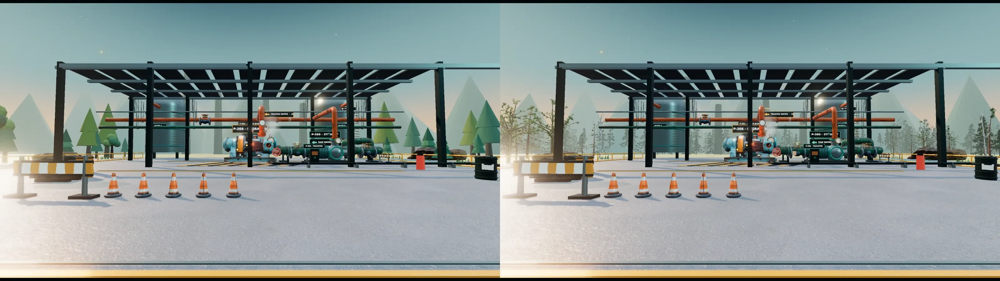
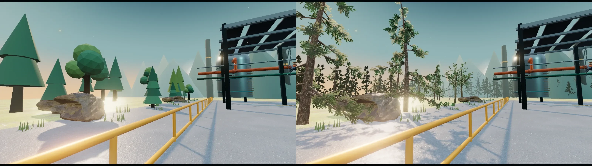

# Tree replacement verification

Baseline: `5c86b8fa2ce6e38be302372a104c5f9f36ab8c65`. Tree runtime: `101676a72bc2b0fc21e91151d766c48921449388`.

## Geometry budget

| Path | Tree triangles | Limit | Main tree draw calls | Trees |
| --- | ---: | ---: | ---: | --- |
| Desktop | 82,060 | 150,000 | 15 | 16 near, 48 mid, 240 far |
| Coarse pointer | 49,956 | 60,000 | 15 | 16 near, 48 mid, 240 far |
| Software WebGL | 960 | 60,000 | 1 | 240 far |

Each species has at most five colour-pass submissions including the shared impostor mesh. Near trees cast and receive sun shadows. The full-scene counters below include shadow and composer passes; they are not the tree-only budget. All eight GLBs are below 0.8 MB each.

## Captures

All views use a 1600 by 900 viewport. Camera positions and targets are fixed by `tools/trees/capture.mjs`. Desktop uses pixel ratio 1.4; coarse pointer uses 1.1; the software path uses 0.78. Files named `before-*` and `after-*` provide title, yard, west and east views. Comparison images show before on the left and after on the right.

The verification machine uses Chrome Headless Shell and SwiftShader. Desktop and coarse-pointer paths are forced only in the temporary capture bundle. These tests confirm geometry budgets, shaders, loaded assets and fallback behaviour. They do not establish frame rates on a physical laptop or phone. Hardware profiling remains pending.

## Complete scene measurements

Frame time is the median of three warm renders, measured with GPU completion after one warmup render. Software rasterization and shared CPU contention can dominate these values. Raw measurements and browser errors are retained in the adjacent JSON files.

| Phase | Path | View | Pixel ratio | Scene triangles | Scene draw calls | Software frame ms |
| --- | --- | --- | ---: | ---: | ---: | ---: |
| before | desktop | title | 1.4 | 847,246 | 2441 | 12.5 |
| before | desktop | yard | 1.4 | 847,150 | 2439 | 14.9 |
| before | desktop | west | 1.4 | 394,050 | 1017 | 4.1 |
| before | desktop | east | 1.4 | 384,854 | 1024 | 6.3 |
| before | mobile | title | 1.1 | 846,462 | 2401 | 18.0 |
| before | mobile | yard | 1.1 | 846,334 | 2397 | 9.1 |
| before | mobile | west | 1.1 | 394,110 | 1020 | 5.6 |
| before | mobile | east | 1.1 | 384,494 | 1006 | 9.9 |
| before | software | title | 0.78 | 520,434 | 1644 | 11.6 |
| before | software | yard | 0.78 | 520,338 | 1642 | 8.5 |
| before | software | west | 0.78 | 67,650 | 240 | 1.4 |
| before | software | east | 0.78 | 58,554 | 253 | 1.3 |
| after | desktop | title | 1.4 | 1,046,614 | 2187 | 37.5 |
| after | desktop | yard | 1.4 | 1,046,486 | 2183 | 7.4 |
| after | desktop | west | 1.4 | 513,202 | 841 | 4.2 |
| after | desktop | east | 1.4 | 504,148 | 862 | 3.5 |
| after | mobile | title | 1.1 | 950,302 | 2187 | 38.3 |
| after | mobile | yard | 1.1 | 950,174 | 2183 | 8.5 |
| after | mobile | west | 1.1 | 448,994 | 841 | 3.9 |
| after | mobile | east | 1.1 | 439,892 | 861 | 4.2 |
| after | software | title | 0.78 | 518,266 | 1498 | 24.5 |
| after | software | yard | 0.78 | 518,138 | 1494 | 5.8 |
| after | software | west | 0.78 | 66,002 | 167 | 0.9 |
| after | software | east | 0.78 | 58,274 | 187 | 1.9 |

## Checks

Factory Shift standalone build, TypeScript, lint, artifact validation and all five rendered HTML tests passed on this revision. All captured browser error arrays are empty. All nine tree asset URLs at the pinned asset commit returned HTTP 200.

The repository-wide Quality workflow reports two unrelated failures in unchanged Studio code: three Rust Clippy `assert_is_empty` warnings in `crates/studio-core/src/database.rs`, and two ESLint `no-unsafe-call` errors in `apps/studio/src/App.test.tsx`. Those files, the Studio dependencies and its workflow were not changed. No branch protection or check configuration was changed.

## Reproduce

Install the root workspace dependencies and the dependencies in `tools/trees`, then run the commands in `tools/trees/README.md`. Run `node tools/trees/report.mjs` from the app directory to rebuild this report and WebP comparisons. PNG captures are intermediate files; the report stores compressed WebP copies.

The runtime and assets use the existing publish workflow. `app/factory-scene.tsx` pins assets to `cdc4d9c60a24e3d1dd136bf563727c80f0001c11`, which already contains every model and atlas. The publish workflow builds standalone code and updates the game-lite bundle pin. See the [production release record](RELEASE.md) for the live capture and observed bundle URLs.
