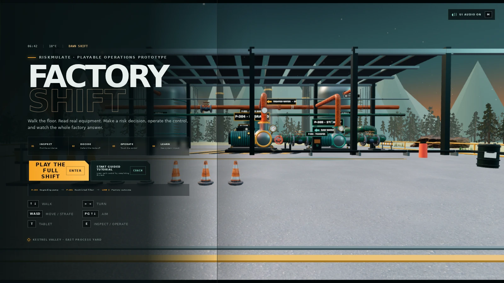

# Production release

- URL: https://riskmulate.vercel.app
- Target: production
- Status: READY, with the production alias assigned
- Production commit: `3023363893bc584531b60c14cd71a86aec854ab7`
- Tree change: [PR 65](https://github.com/TheFiregram/RiskMulate/pull/65), merged as `7e4dfc6206ac02b9e685f420a68c305fba294bf6`
- Standalone bundle commit: `2f73d4e85ec01a43a84ade0bcf8adfe3938383c1`
- Public asset commit: `cdc4d9c60a24e3d1dd136bf563727c80f0001c11`
- Framework: static game-lite shell with the standalone React and Three.js bundle
- Vercel build duration: 59.4 seconds
- Publishing workflow: [38093528335](https://github.com/TheFiregram/RiskMulate/actions/runs/38093528335), successful
- Error scan: no error or fatal runtime logs returned for this deployment over the latest five minutes

The existing workflow rebuilt standalone code and rewrote both bundle references in `apps/game-lite/index.html`. The deployment checks verified the intended project, team, production commit and alias. No project settings, workflow rules or gameplay code were changed for this release.

## Public-page verification

A fresh Chrome Headless Shell capture completed at `2026-10-10T23:05:41.916Z`. It loaded the new JS and CSS bundle, the pinned tree atlas and the EZ-Tree credit. The capture recorded zero browser errors and no failed tree assets. Native software-renderer detection selected the intended far-only path: 240 impostors, 960 triangles, one tree draw call. Desktop and coarse-pointer geometry paths are covered by the separate local captures.

Raw production observations are in `live-verification.json`. All nine pinned tree asset URLs were checked separately and returned HTTP 200. The original PNG captures were compressed to WebP for repository delivery.

## Verification limits

Physical laptop and phone frame rates have not been measured. The full-scene timing table comes from SwiftShader and must not be treated as hardware performance evidence. Repository-wide Quality failures in unchanged Studio tests are documented in `README.md`; Factory Shift checks pass. Log drains and continuous monitoring were not changed or audited.
